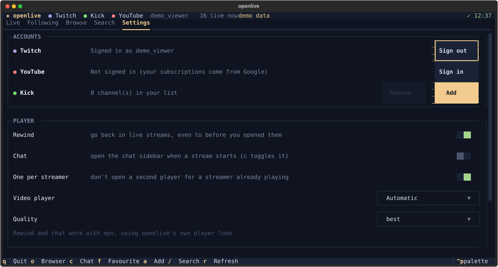

# openlive

**¿Quién de los que ves está en directo ahora?** `openlive` es un panel en la terminal con los canales de Twitch, Kick y YouTube que ves y que están emitiendo en este momento. Eliges uno y se abre en tu propio reproductor (mpv, IINA o VLC), no en una pestaña del navegador.

Funciona en tu ordenador y solo habla con esas webs. Para entrar en Twitch basta un código, sin claves: abres twitch.tv/activate, compruebas el código y pulsas Activar. YouTube funciona igual con Google, para traer tus suscripciones. Kick no necesita cuenta.

[English](README.md)


## Funciones

- **Primero los directos, todas las plataformas en una lista.** Los canales que ves que están en directo, con categoría, espectadores, tiempo y título, marcados `TW`, `KI` o `YT`. Se recarga solo cada minuto.
- **Sin navegador.** `Enter` abre el directo en mpv, IINA o VLC. `o` abre el canal en el navegador y `c` abre su chat aparte.
- **Rebobina el directo, incluso a antes de abrirlo.** Con mpv, `←` retrocede y `Fin` vuelve al directo: en Twitch y Kick hasta el principio del directo, en YouTube hasta una hora si el canal lo permite.
- **Seguidos de Twitch, sin claves.** Inicias sesión una vez con un código y tus seguidos salen de tu cuenta. Sin cuenta de desarrollador, sin Client ID, sin secretos que copiar.
- **Suscripciones de YouTube con Google.** Inicias sesión una vez con un código (`g`); openlive solo lee tus suscripciones. De YouTube solo salen directos, nunca vídeos.
- **Kick: buscas mientras escribes.** `a`, unas letras y eliges el canal. Kick no dice a quién sigues, así que openlive guarda esa lista.
- **Muestra u oculta una plataforma.** Haz clic en su etiqueta de la barra superior o pulsa `t`, `k` o `y`.
- **Siguiendo, Explorar y Buscar.** Todos los que ves (primero los que están en directo), los directos más vistos de Twitch y una sola búsqueda en Twitch, Kick y YouTube, con una sección por plataforma.
- **Un reproductor con el estilo de openlive.** mpv con su propia barra: iconos vectoriales, barra de volumen (se recuerda entre directos), una pastilla de directo que te devuelve a él, tooltips y una línea de tiempo que puedes arrastrar.
- **El chat junto al vídeo.** Una barra lateral con el chat de Twitch en mpv, cerrada hasta que la abres, con emojis y emotes de Twitch. Con la rueda del ratón vuelves atrás (el chat te espera y cuenta los mensajes nuevos), puedes pausarlo y escribes con `Enter`.
- **Pestaña de Ajustes.** Iniciar y cerrar sesión, tus canales de Kick, rebobinar o solo directo, abrir el chat al empezar, un reproductor por streamer, reproductor, calidad e idioma (`5`).
- **Favoritos arriba.** `f` fija un canal arriba en todas las listas.
- **Ratón y teclado.** Clic en una cabecera para ordenar, `/` para filtrar. Funciona desde 80 columnas.
- **Inglés y español.**

| Siguiendo | Añadir canales de Kick / YouTube |
|---|---|
|  |  |
| **Buscar (todas las plataformas)** | **Ajustes** |
|  |  |

## Instalación

No necesitas tener Python ni nada instalado. Abre una terminal y pega una línea.

**macOS y Linux** (Terminal):

```bash
curl -LsSf https://raw.githubusercontent.com/xlydevs/openlive/main/install.sh | sh
```

**Windows** (PowerShell):

```powershell
irm https://raw.githubusercontent.com/xlydevs/openlive/main/install.ps1 | iex
```

Instala [uv](https://docs.astral.sh/uv/) (un programa pequeño que trae su propio Python), después openlive y, si falta, el reproductor [mpv](https://mpv.io) (con Homebrew en macOS, winget en Windows y tu gestor de paquetes en Linux). Luego abre una terminal nueva y ejecuta:

```bash
openlive
```

Para actualizar, pega la misma línea otra vez. Para quitarlo: `uv tool uninstall openlive`. Puedes leer antes los dos scripts: [install.sh](install.sh), [install.ps1](install.ps1).

¿Ya tienes uv o pipx? `uv tool install "openlive @ https://github.com/xlydevs/openlive/archive/refs/heads/main.tar.gz"` hace lo mismo (Python 3.11+). IINA y VLC también funcionan, sin rebobinado ni chat.

Si aun así no tienes reproductor, openlive se ofrece a instalar mpv la primera vez que abres un directo (con Homebrew en macOS y winget en Windows; en Linux te enseña la línea `sudo apt/dnf/pacman` que debes ejecutar). También busca mpv donde lo dejan los instaladores de Windows y avisa una vez si tu mpv es demasiado antiguo para escribir en el chat (0.38+).

La primera vez, openlive te pregunta qué plataformas ves. Después Twitch y YouTube te piden iniciar sesión con un código, y Kick te pide algunos canales.

Pruébalo sin ninguna cuenta. La demo usa canales inventados y no lee ni escribe nada:

```bash
openlive --demo
```

Desde el código:

```bash
git clone https://github.com/xlydevs/openlive && cd openlive
uv venv && uv pip install -e ".[dev]"
.venv/bin/openlive
```

## Uso

```text
openlive               abre el panel (la primera vez: eliges plataformas e inicias sesión)
openlive --text        muestra quién está en directo y sale (también al usar una tubería: openlive | less)
openlive --demo        canales inventados
openlive --lang en     idioma de la interfaz (por defecto: el del sistema)
```

**Teclas:**
- `1`–`5` cambian de pestaña: En directo, Siguiendo, Explorar, Buscar, Ajustes.
- `↑`/`↓` moverse, `Enter` ver (los canales offline se abren en el navegador).
- `o` abrir en el navegador, `c` chat, `f` favorito.
- `a` añadir canales de Kick / YouTube, `x` quitar de tu lista el seleccionado.
- `t`, `k`, `y` muestran u ocultan Twitch, Kick y YouTube; `p` elige las plataformas.
- `/` filtra la lista (en Buscar: escribe un canal o juego y pulsa `Enter`; busca en todas las plataformas que usas), `Esc` lo borra.
- `r` recargar, `l` iniciar sesión en Twitch, `g` iniciar sesión con Google, `Ctrl+P` paleta de comandos (ahí está cerrar sesión), `q` salir.
- Clic en la cabecera de una columna para ordenar; otro clic invierte el orden.

**En el reproductor (mpv):**
- `←`/`→` 10 segundos atrás o adelante, `Mayús+←`/`Mayús+→` 5 minutos.
- `Fin` (o `l`) vuelve al directo, `Espacio` pausa, `↑`/`↓` volumen, `m` silencio, `f` pantalla completa.
- `c` abre o cierra el chat (empieza cerrado; en Ajustes puedes hacer que se abra al empezar).
- Chat: rueda del ratón o `RePág`/`AvPág` para ver mensajes anteriores, el botón de pausa para pararlo, `Enter` (o **Escribir**) para escribir.
- Mueve el ratón para ver la barra de controles: clic en la línea de tiempo para saltar, en `● −5:03` para volver al directo.

**YouTube sin iniciar sesión:** en [Google Takeout](https://takeout.google.com/takeout/custom/youtube) marca solo YouTube → suscripciones, exporta, descomprime y pega la ruta de `subscriptions.csv` en el diálogo de `a`.

## Cómo funciona

Twitch usa su [flujo de código de dispositivo](https://dev.twitch.tv/docs/authentication/getting-tokens-oauth/#device-code-grant-flow) y pide dos permisos: `user:read:follows`, para leer a quién sigues, y `user:write:chat`, para enviar lo que escribes en el chat del reproductor. No puede seguir ni dejar de seguir canales ni cambiar nada más de tu cuenta. Si iniciaste sesión antes de que se pudiera escribir, vuelve a iniciarla (`l`) para escribir.

Google usa el mismo tipo de inicio de sesión con código y pide `youtube.readonly`: openlive lee tus suscripciones y nada más. Para gastar casi nada de cuota de la API, lee el feed RSS de cada canal y solo pregunta a la API por los vídeos nuevos; los que ya sabe que han terminado los recuerda.

**Google mientras openlive es nuevo:** hasta que Google revise la app de openlive, solo deja entrar a las cuentas añadidas como testers y muestra un aviso de "app no verificada". Mientras tanto puedes importar tus suscripciones desde Takeout, añadir canales a mano o usar tu propio cliente de Google (`[youtube] client_id` y `client_secret`, un cliente de tipo "TVs and Limited Input devices").

Kick no ofrece una forma pública de que una app así lea a quién sigues, así que openlive guarda su propia lista de canales y comprueba cada uno.

| Plataforma | Qué | De dónde sale |
|---|---|---|
| Twitch | En directo, Siguiendo | Helix `streams/followed`, `channels/followed` |
| Twitch | Explorar, Buscar | Helix `streams` (los más vistos; `browse_language` los filtra), `search/channels` |
| Kick | buscar | `kick.com/api/search` (pública, sin clave) |
| YouTube | buscar | yt-dlp sobre la página de búsqueda de YouTube con su filtro "En directo" (sin gastar cuota de la API) |
| Kick | comprobar directo | `kick.com/api/v2/channels/<slug>` (pública, sin clave) |
| YouTube | suscripciones | `subscriptions?mine=true` (con la sesión de Google) |
| YouTube | comprobar directo | feed RSS + `videos.list` (con sesión o clave de API); si no, la página `/live` del canal |
| Twitch | chat | leído de forma anónima del servidor de chat de Twitch; emotes de `static-cdn.jtvnw.net`; escribir con Helix `chat/messages` |
| Twitch | rebobinar | Helix `videos`: la grabación que Twitch hace del directo, que crece mientras emite |
| Kick | rebobinar | `kick.com/api/v2/channels/<slug>/videos`: su grabación del directo |
| YouTube | rebobinar | yt-dlp: las listas separadas de vídeo y audio guardan la ventana DVR del canal (hasta ~1 h) |
| Todas | reproducción | mpv con la configuración propia de openlive (su barra de controles, el chat lateral y el script para rebobinar, en `src/openlive/mpv/`); otros reproductores con `streamlink` |

**Aviso sincero:** la API de canales de Kick y la página `/live` de YouTube no son APIs oficiales ni documentadas. Hoy funcionan y no piden claves, pero cualquiera de las dos webs puede cambiarlas y romper la comprobación hasta que se actualice openlive. Con una [clave de la API de datos de YouTube](https://console.cloud.google.com/apis/library/youtube.googleapis.com) (`[youtube] api_key` en la configuración; la cuota gratuita sobra) YouTube usa la API oficial.

Ficheros que guarda:

| Fichero | Qué |
|---|---|
| `~/.config/openlive/config.toml` | ajustes opcionales: plataformas, reproductor, calidad, idioma, clave de YouTube… mira [config.example.toml](config.example.toml) |
| `~/.local/share/openlive/auth.json` | tu token de Twitch (solo lo puedes leer tú) |
| `~/.local/share/openlive/google_auth.json` | tu token de Google (solo lo puedes leer tú) |
| `~/.local/share/openlive/youtube_subs.json`, `youtube_seen.json` | tus suscripciones (se renuevan cada 12 h) y los vídeos que ya sabe que no son directos |
| `~/.local/share/openlive/mpv/` | la configuración de mpv de openlive; tu `~/.config/mpv` no se toca |
| `~/.local/share/openlive/emotes/` | las imágenes de emotes de Twitch ya descargadas |
| `~/.local/share/openlive/channels.json` | tus canales de Kick y YouTube |
| `~/.local/share/openlive/favourites.json` | tus favoritos |
| `~/.local/share/openlive/cache.json` | la última lista de directos, para que la app abra al instante |

En Windows están en `%APPDATA%\openlive` y `%LOCALAPPDATA%\openlive`. `$OPENLIVE_CONFIG` y `$OPENLIVE_DATA_DIR` los cambian.

**Rebobinar:** en Twitch el streamer tiene que guardar sus directos (casi todos lo hacen; los que son solo para suscriptores no se pueden abrir). En YouTube solo se puede en canales con DVR. Si no, mpv puede volver igualmente hasta el momento en que abriste el directo. `player_ui = "plain"` usa tu propia configuración de mpv, sin rebobinar.

**Chat:** una barra lateral con el chat de Twitch en mpv (`c` la abre). openlive la dibuja como imagen (con Pillow) porque el motor de texto de mpv no sabe mostrar emojis en color. Guarda los últimos 2000 mensajes. Los emojis compuestos (👩‍💻) muestran solo su primera parte y los emotes de 7TV/BTTV salen como texto. Todavía no hay chat de Kick ni de YouTube. Para escribir hace falta mpv 0.38 o más nuevo.

**No incluye:** chat dentro de la terminal; VODs de directos pasados, clips ni vídeos normales de YouTube; Explorar en Kick o YouTube (no hay API pública para eso). Los anuncios y los directos solo para suscriptores se comportan como en streamlink.

**Privacidad:** no se envía nada a ningún sitio salvo a Twitch, Kick, YouTube y Google (para iniciar sesión). Sin analíticas.

## Desarrollo

```bash
uv venv && uv pip install -e ".[dev]"
.venv/bin/python -m pytest -q        # los tests nunca usan la red ni tu token real
uvx ruff check .
.venv/bin/python scripts/screenshots.py   # docs/screenshots/*.svg con datos de demo
vhs scripts/demo.tape                     # docs/demo.gif
```

Usar tu propia app de Twitch: crea una app **Public** en [dev.twitch.tv](https://dev.twitch.tv/console/apps/create) (redirección `http://localhost`) y pon `client_id` en la configuración o en `$OPENLIVE_CLIENT_ID`.

openlive no está afiliado a Twitch, Kick ni YouTube, ni cuenta con su respaldo.

## Licencia

[MIT](LICENSE)
