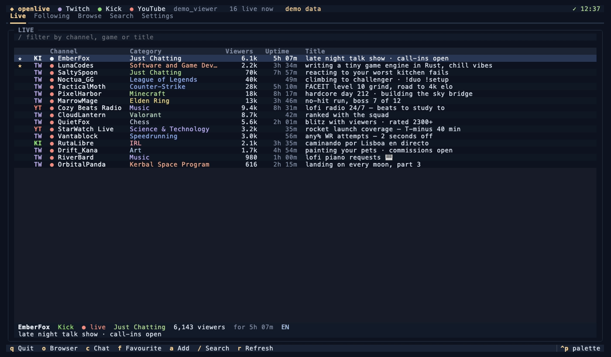
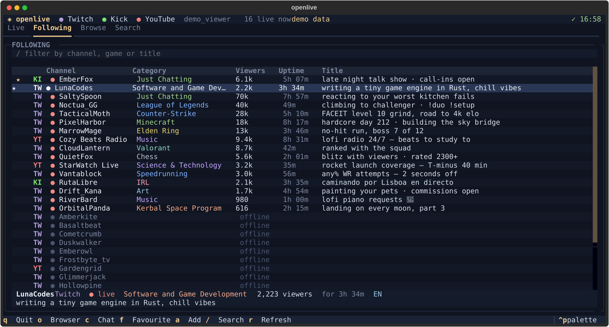
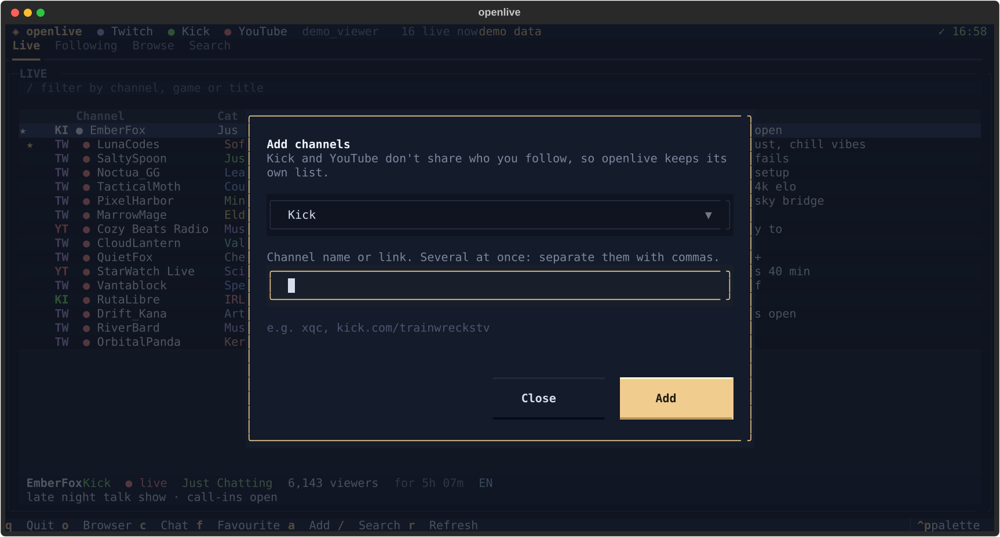

# openlive

**¿Quién de los que ves está en directo ahora?** `openlive` es un panel en la terminal con los canales de Twitch, Kick y YouTube que ves y que están emitiendo en este momento. Eliges uno y se abre en tu propio reproductor (mpv, IINA o VLC), no en una pestaña del navegador.

Funciona en tu ordenador y solo habla con esas webs. Para entrar en Twitch basta un código, sin claves: abres twitch.tv/activate, compruebas el código y pulsas Activar. Kick y YouTube no necesitan cuenta.

[English](README.md)



## Funciones

- **Primero los directos, todas las plataformas en una lista.** Los canales que ves que están en directo, con categoría, espectadores, tiempo y título, marcados `TW`, `KI` o `YT`. Se recarga solo cada minuto.
- **Sin navegador.** `Enter` abre el directo con streamlink en mpv, IINA o VLC. `o` abre el canal en el navegador y `c` abre su chat aparte.
- **Seguidos de Twitch, sin claves.** Inicias sesión una vez con un código y tus seguidos salen de tu cuenta. Sin cuenta de desarrollador, sin Client ID, sin secretos que copiar.
- **Listas de Kick y YouTube.** Añade canales por nombre o enlace con `a` y quítalos con `x`. Importa tus suscripciones de YouTube desde Google Takeout. De YouTube solo salen directos, nunca vídeos.
- **Muestra u oculta una plataforma.** Haz clic en su etiqueta de la barra superior o pulsa `t`, `k` o `y`.
- **Siguiendo, Explorar y Buscar.** Todos los que ves (primero los que están en directo), los directos más vistos de Twitch y una búsqueda de cualquier canal o juego de Twitch.
- **Favoritos arriba.** `f` fija un canal arriba en todas las listas.
- **Ratón y teclado.** Clic en una cabecera para ordenar, `/` para filtrar. Funciona desde 80 columnas.
- **Inglés y español.**

| Siguiendo | Añadir canales de Kick / YouTube |
|---|---|
|  |  |

## Instalación

Necesitas Python 3.11+ y un reproductor: [mpv](https://mpv.io) (recomendado), [IINA](https://iina.io) en macOS o [VLC](https://www.videolan.org/vlc/). streamlink se instala con openlive.

```bash
pipx install openlive        # o: uv tool install openlive
openlive
```

En macOS, `brew install mpv` te da un reproductor.

La primera vez, openlive te pregunta qué plataformas ves. Después Twitch te pide iniciar sesión, y Kick y YouTube te piden algunos canales.

Pruébalo sin ninguna cuenta. La demo usa canales inventados y no lee ni escribe nada:

```bash
openlive --demo
```

Desde el código:

```bash
git clone https://github.com/xlydevs/openlive && cd openlive
uv venv && uv pip install -e ".[dev]"
.venv/bin/openlive
```

## Uso

```text
openlive               abre el panel (la primera vez: eliges plataformas e inicias sesión)
openlive <canal>       ve un canal de Twitch directamente
openlive --text        muestra quién está en directo y sale (también al usar una tubería: openlive | less)
openlive --login       inicia sesión en Twitch desde la terminal, sin el panel
openlive --logout      cierra la sesión de Twitch y borra el token guardado
openlive --demo        canales inventados
openlive --lang en     idioma de la interfaz (por defecto: el del sistema)
```

**Teclas:**
- `1`–`4` cambian de pestaña: En directo, Siguiendo, Explorar, Buscar.
- `↑`/`↓` moverse, `Enter` ver (los canales offline se abren en el navegador).
- `o` abrir en el navegador, `c` chat, `f` favorito.
- `a` añadir canales de Kick / YouTube, `x` quitar de tu lista el seleccionado.
- `t`, `k`, `y` muestran u ocultan Twitch, Kick y YouTube; `p` elige las plataformas.
- `/` filtra la lista (en Buscar: escribe un canal o juego y pulsa `Enter`), `Esc` lo borra.
- `r` recargar, `l` iniciar sesión en Twitch, `Ctrl+P` paleta de comandos (ahí está cerrar sesión), `q` salir.
- Clic en la cabecera de una columna para ordenar; otro clic invierte el orden.

**Suscripciones de YouTube:** en [Google Takeout](https://takeout.google.com/takeout/custom/youtube) marca solo YouTube → suscripciones, exporta, descomprime y pega la ruta de `subscriptions.csv` en el diálogo de `a`.

## Cómo funciona

Twitch usa su [flujo de código de dispositivo](https://dev.twitch.tv/docs/authentication/getting-tokens-oauth/#device-code-grant-flow) y pide un solo permiso, `user:read:follows`, para leer a quién sigues y nada más. No puede escribir en el chat, seguir canales ni cambiar nada de tu cuenta.

Kick y YouTube no ofrecen una forma pública de que una app así lea a quién sigues, así que openlive guarda su propia lista de canales y comprueba cada uno.

| Plataforma | Qué | De dónde sale |
|---|---|---|
| Twitch | En directo, Siguiendo | Helix `streams/followed`, `channels/followed` |
| Twitch | Explorar, Buscar | Helix `streams` (los más vistos; `browse_language` los filtra), `search/channels` |
| Kick | comprobar directo | `kick.com/api/v2/channels/<slug>` (pública, sin clave) |
| YouTube | comprobar directo | la página `/live` del canal o, con clave de API, el feed RSS + `videos.list` |
| Todas | reproducción | `streamlink <url> best --player <el tuyo>` |

**Aviso sincero:** la API de canales de Kick y la página `/live` de YouTube no son APIs oficiales ni documentadas. Hoy funcionan y no piden claves, pero cualquiera de las dos webs puede cambiarlas y romper la comprobación hasta que se actualice openlive. Con una [clave de la API de datos de YouTube](https://console.cloud.google.com/apis/library/youtube.googleapis.com) (`[youtube] api_key` en la configuración; la cuota gratuita sobra) YouTube usa la API oficial.

Ficheros que guarda:

| Fichero | Qué |
|---|---|
| `~/.config/openlive/config.toml` | ajustes opcionales: plataformas, reproductor, calidad, idioma, clave de YouTube… mira [config.example.toml](config.example.toml) |
| `~/.local/share/openlive/auth.json` | tu token de Twitch (solo lo puedes leer tú) |
| `~/.local/share/openlive/channels.json` | tus canales de Kick y YouTube |
| `~/.local/share/openlive/favourites.json` | tus favoritos |
| `~/.local/share/openlive/cache.json` | la última lista de directos, para que la app abra al instante |

En Windows están en `%APPDATA%\openlive` y `%LOCALAPPDATA%\openlive`. `$OPENLIVE_CONFIG` y `$OPENLIVE_DATA_DIR` los cambian.

**No incluye:** chat dentro de la terminal; VODs, clips ni vídeos normales de YouTube; Explorar y Buscar en Kick o YouTube (no hay API pública para eso); `openlive <canal>` para Kick o YouTube. Los anuncios y los directos solo para suscriptores se comportan como en streamlink.

**Privacidad:** no se envía nada a ningún sitio salvo a Twitch, Kick y YouTube. Sin analíticas.

## Desarrollo

```bash
uv venv && uv pip install -e ".[dev]"
.venv/bin/python -m pytest -q        # los tests nunca usan la red ni tu token real
uvx ruff check .
.venv/bin/python scripts/screenshots.py   # docs/screenshots/*.svg con datos de demo
vhs scripts/demo.tape                     # docs/demo.gif
```

Usar tu propia app de Twitch: crea una app **Public** en [dev.twitch.tv](https://dev.twitch.tv/console/apps/create) (redirección `http://localhost`) y pon `client_id` en la configuración o en `$OPENLIVE_CLIENT_ID`.

openlive no está afiliado a Twitch, Kick ni YouTube, ni cuenta con su respaldo.

## Licencia

[MIT](LICENSE)
