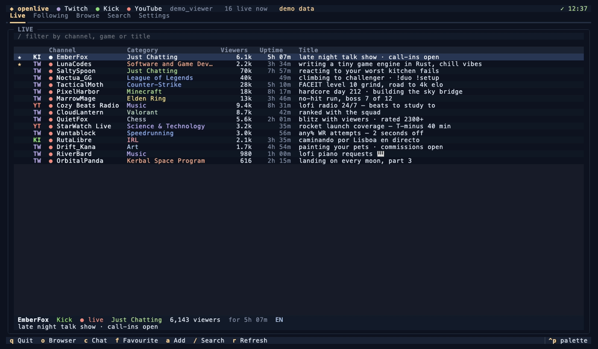
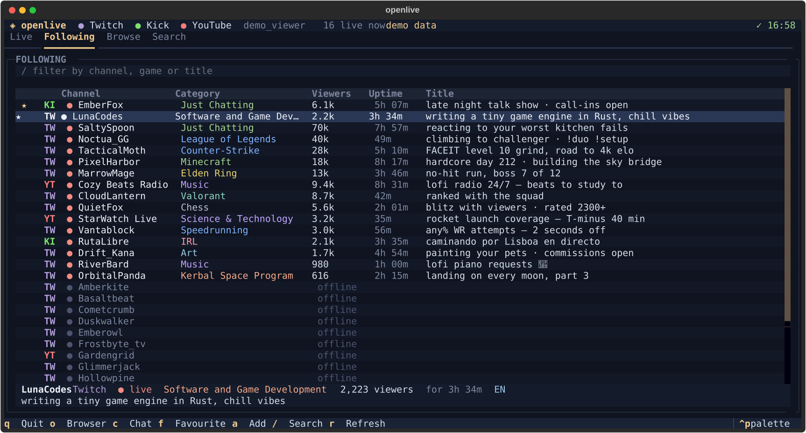
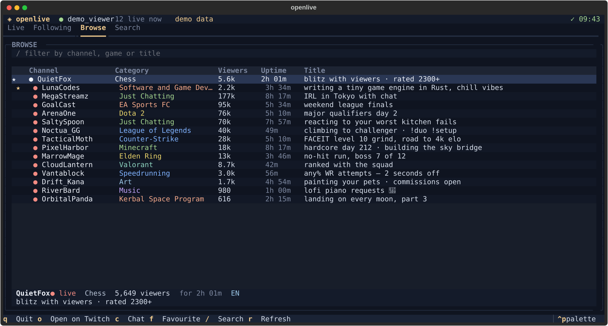

# openlive

**Who you follow is live right now?** `openlive` is a terminal dashboard of the Twitch channels you follow that are streaming at this moment. Pick one and it plays in your own video player (mpv, IINA or VLC), not in a browser tab.

It runs on your computer and talks only to Twitch. Signing in takes a code, not keys: you open twitch.tv/activate, check the code and press Activate.

[Español](README.es.md)



## Features

- **Live first.** The channels you follow that are live, with category, viewers, uptime and title. It refreshes on its own every minute.
- **Watch without the browser.** `Enter` opens the stream through streamlink in mpv, IINA or VLC, with low latency. `o` opens the channel on Twitch, `c` pops out its chat.
- **Following, Browse and Search.** Everyone you follow (live first), the top streams on Twitch, and a search for any channel or game.
- **Favourites on top.** `f` pins a channel to the top of every list.
- **Sign in once, no keys.** No developer account, no Client ID, no secret to copy. The token is stored only on your computer and refreshes itself.
- **Mouse and keyboard.** Click a header to sort, `/` to filter. Works from 80 columns up.
- **English and Spanish.**

| Following | Browse |
|---|---|
|  |  |

## Install

You need Python 3.11+ and a video player: [mpv](https://mpv.io) (recommended), [IINA](https://iina.io) on macOS, or [VLC](https://www.videolan.org/vlc/). streamlink is installed with openlive.

```bash
pipx install openlive        # or: uv tool install openlive
openlive
```

On macOS, `brew install mpv` gets you a player.

Try it without a Twitch account. The demo uses made-up channels and reads and writes nothing:

```bash
openlive --demo
```

From source:

```bash
git clone https://github.com/xlydevs/openlive && cd openlive
uv venv && uv pip install -e ".[dev]"
.venv/bin/openlive
```

## Usage

```text
openlive               open the dashboard (asks you to sign in the first time)
openlive <channel>     watch a channel right away
openlive --text        print who is live and exit (also used when piping: openlive | less)
openlive --login       sign in from the terminal, without the dashboard
openlive --logout      sign out and delete the saved token
openlive --demo        made-up channels
openlive --lang es     interface language (default: system locale)
```

**Keys:**
- `1`–`4` switch tabs: Live, Following, Browse, Search.
- `↑`/`↓` move, `Enter` watch (offline channels open on Twitch).
- `o` open on Twitch, `c` chat, `f` favourite.
- `/` filter the list (in Search: type a channel or game and press `Enter`), `Esc` clear it.
- `r` refresh, `l` sign in, `Ctrl+P` command palette (sign out is there), `q` quit.
- Click a column header to sort; click again to reverse.

## How it works

openlive signs in with Twitch's [device code flow](https://dev.twitch.tv/docs/authentication/getting-tokens-oauth/#device-code-grant-flow). It asks for one permission, `user:read:follows`, so it can read who you follow and nothing else. It can't chat, follow or change anything on your account.

| What | Where it comes from |
|---|---|
| Live tab | Helix `streams/followed` |
| Following tab | Helix `channels/followed` plus who is live |
| Browse tab | Helix `streams` (top by viewers; `browse_language` filters it) |
| Search tab | Helix `search/channels` |
| Playback | `streamlink https://twitch.tv/<channel> best --player <yours>` |

Files it keeps:

| File | What |
|---|---|
| `~/.config/openlive/config.toml` | optional settings: player, quality, language… see [config.example.toml](config.example.toml) |
| `~/.local/share/openlive/auth.json` | your sign-in token (only readable by you) |
| `~/.local/share/openlive/favourites.json` | your favourites |
| `~/.local/share/openlive/cache.json` | last Live list, so the app opens instantly |

On Windows they live in `%APPDATA%\openlive` and `%LOCALAPPDATA%\openlive`. `$OPENLIVE_CONFIG` and `$OPENLIVE_DATA_DIR` override them.

**Not supported:** chat inside the terminal, VODs and clips, other platforms (YouTube, Kick). Ads and sub-only streams behave as they do in streamlink.

**Privacy:** nothing is sent anywhere but Twitch. No analytics.

## Development

```bash
uv venv && uv pip install -e ".[dev]"
.venv/bin/python -m pytest -q        # tests never touch the network or your real token
uvx ruff check .
.venv/bin/python scripts/screenshots.py   # docs/screenshots/*.svg from demo data
vhs scripts/demo.tape                     # docs/demo.gif
```

Using your own Twitch app: create a **Public** app at [dev.twitch.tv](https://dev.twitch.tv/console/apps/create) (redirect `http://localhost`), then set `client_id` in the config or `$OPENLIVE_CLIENT_ID`.

openlive is not affiliated with or endorsed by Twitch.

## License

[MIT](LICENSE)
