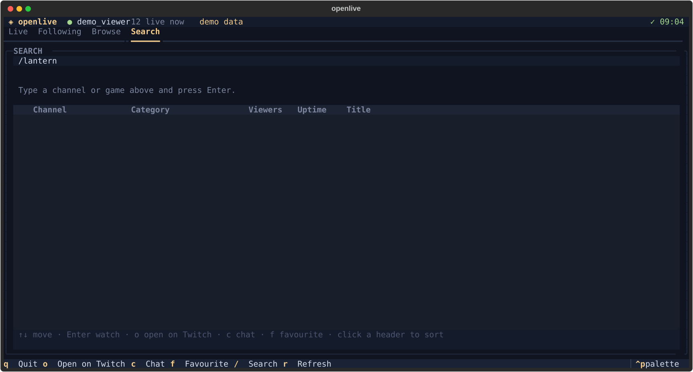

# openlive

**Who you watch is live right now?** `openlive` is a terminal dashboard of the Twitch, Kick and YouTube channels you watch that are streaming at this moment. Pick one and it plays in your own video player (mpv, IINA or VLC), not in a browser tab.

It runs on your computer and talks only to those sites. Twitch sign-in takes a code, not keys: you open twitch.tv/activate, check the code and press Activate. YouTube works the same way with Google, to bring your subscriptions. Kick needs no account.

[Español](README.es.md)


## Features

- **Live first, every platform in one list.** The channels you watch that are live, with category, viewers, uptime and title, tagged `TW`, `KI` or `YT`. It refreshes on its own every minute.
- **Watch without the browser.** `Enter` opens the stream in mpv, IINA or VLC. `o` opens the channel in the browser, `c` pops out its chat.
- **Rewind the live stream, even to before you opened it.** With mpv, `←` goes back and `End` returns to live: on Twitch and Kick back to the start of the stream, on YouTube up to an hour when the channel allows it.
- **Twitch follows, no keys.** Sign in once with a code; your follows come from your account. No developer account, no Client ID, no secret to copy.
- **YouTube subscriptions with Google.** Sign in once with a code (`g`); openlive only reads your subscriptions. YouTube shows live streams only, never videos.
- **Kick search as you type.** `a`, type a few letters, pick the channel. Kick doesn't share who you follow, so openlive keeps that list.
- **Show or hide a platform.** Click its chip in the top bar, or press `t`, `k` or `y`.
- **Following, Browse and Search.** Everyone you watch (live first), the top streams on Twitch, and one search across Twitch, Kick and YouTube, with a section per platform.
- **A player that looks like openlive.** mpv with its own control bar: vector icons, a volume slider (remembered between streams), a live pill that takes you back, tooltips and a timeline you can drag.
- **Chat next to the video.** A Twitch chat sidebar in mpv, closed until you open it, with emoji and Twitch emotes. Scroll back with the mouse wheel (the chat waits for you and counts new messages), pause it, and write with `Enter`.
- **Settings tab.** Sign in and out, your Kick channels, rewind or live only, open the chat on start, one player per streamer, player, quality and language (`5`).
- **Favourites on top.** `f` pins a channel to the top of every list.
- **Mouse and keyboard.** Click a header to sort, `/` to filter. Works from 80 columns up.
- **English and Spanish.**

| Following | Add Kick / YouTube channels |
|---|---|
|  |  |
| **Search (every platform)** | **Settings** |
|  |  |

## Install

You don't need Python or anything else first. Open a terminal and paste one line.

**macOS and Linux** (Terminal):

```bash
curl -LsSf https://raw.githubusercontent.com/xlydevs/openlive/main/install.sh | sh
```

**Windows** (PowerShell):

```powershell
irm https://raw.githubusercontent.com/xlydevs/openlive/main/install.ps1 | iex
```

It installs [uv](https://docs.astral.sh/uv/) (one small program that brings its own Python), then openlive, then the [mpv](https://mpv.io) player if it's missing (Homebrew on macOS, winget on Windows, your package manager on Linux). Then open a new terminal and run:

```bash
openlive
```

**Updates:** when a new version is out, openlive tells you and updates itself in the background with one click (`u` brings the dialog back; on Windows it finishes when you close openlive). You can also paste the same line again. To remove it: `uv tool uninstall openlive`. You can read both scripts first: [install.sh](install.sh), [install.ps1](install.ps1).

Already have Python 3.11+? `pipx install openlive` or `uv tool install openlive` (from [PyPI](https://pypi.org/project/openlive/)) work too; you install mpv yourself. openlive plays in mpv; IINA or VLC can be picked in Settings, without rewind and chat.

If there's still no player, openlive offers to install mpv the first time you open a stream (Homebrew on macOS, winget on Windows; on Linux it shows the `sudo apt/dnf/pacman` line to run). It also looks for mpv where Windows installers put it, and says once if your mpv is too old to write in the chat (0.38+).

The first time, openlive asks which platforms you watch. Twitch and YouTube then ask you to sign in with a code; Kick asks for a few channels.

Try it without any account. The demo uses made-up channels and reads and writes nothing:

```bash
openlive --demo
```

From source:

```bash
git clone https://github.com/xlydevs/openlive && cd openlive
uv venv && uv pip install -e ".[dev]"
.venv/bin/openlive
```

## Usage

```text
openlive               open the dashboard (first run: pick platforms, sign in)
openlive --text        print who is live and exit (also used when piping: openlive | less)
openlive --demo        made-up channels
openlive --lang es     interface language (default: system locale)
```

**Keys:**
- `1`–`5` switch tabs: Live, Following, Browse, Search, Settings.
- `↑`/`↓` move, `Enter` watch (offline channels open in the browser).
- `o` open in the browser, `c` chat, `f` favourite.
- `a` add Kick / YouTube channels, `x` remove the selected one from your list.
- `t`, `k`, `y` show or hide Twitch, Kick, YouTube; `p` choose platforms.
- `/` filter the list (in Search: type a channel or game and press `Enter`; it searches every platform you use), `Esc` clear it.
- `r` refresh, `l` sign in to Twitch, `g` sign in with Google, `Ctrl+P` command palette (sign out is there), `q` quit.
- Click a column header to sort; click again to reverse.

**In the player (mpv):**
- `←`/`→` 10 seconds back or forward, `Shift+←`/`Shift+→` 5 minutes.
- `End` (or `l`) back to live, `Space` pause, `↑`/`↓` volume, `m` mute, `f` full screen.
- `c` opens or closes the chat (it starts closed; Settings can open it on start).
- Chat: mouse wheel or `PgUp`/`PgDn` to scroll back, the pause button to stop it, `Enter` (or **Write**) to write.
- Move the mouse for the control bar: click the timeline to jump, `● −5:03` to return to live.

**YouTube without signing in:** in [Google Takeout](https://takeout.google.com/takeout/custom/youtube) pick only YouTube → subscriptions, export, unzip, and paste the path of `subscriptions.csv` in the `a` dialog.

## How it works

Twitch uses its [device code flow](https://dev.twitch.tv/docs/authentication/getting-tokens-oauth/#device-code-grant-flow) and asks for two permissions: `user:read:follows`, to read who you follow, and `user:write:chat`, to send what you write in the player's chat. It can't follow, unfollow or change anything else on your account. If you signed in before writing was added, sign in again (`l`) to write.

Google uses the same kind of code sign-in and asks for `youtube.readonly`: openlive reads your subscriptions and nothing else. To spend almost no API quota, it reads each channel's RSS feed and only asks the API about new videos; videos already known to be finished are remembered.

**Google sign-in while openlive is new:** until Google reviews openlive's app, it only lets in accounts added as testers and shows an "unverified app" warning. Until then you can import your subscriptions from Takeout, add channels by hand, or use your own Google client (`[youtube] client_id` and `client_secret`, a "TVs and Limited Input devices" client).

Kick has no public way for an app like this to read who you follow, so openlive keeps its own list of channels and checks each one.

| Platform | What | Where it comes from |
|---|---|---|
| Twitch | Live, Following | Helix `streams/followed`, `channels/followed` |
| Twitch | Browse, Search | Helix `streams` (top by viewers; `browse_language` filters it), `search/channels` |
| Kick | search | `kick.com/api/search` (public, no key) |
| YouTube | search | yt-dlp on YouTube's search page with its "Live" filter (no API quota) |
| Kick | live check | `kick.com/api/v2/channels/<slug>` (public, no key) |
| YouTube | subscriptions | `subscriptions?mine=true` (signed in with Google) |
| YouTube | live check | RSS feed + `videos.list` (signed in or with an API key), otherwise the channel's `/live` page |
| Twitch | chat | read anonymously from Twitch's chat server; emotes from `static-cdn.jtvnw.net`; writing through Helix `chat/messages` |
| Twitch | rewind | Helix `videos`: the recording Twitch keeps of the live stream, which grows as it goes on |
| Kick | rewind | `kick.com/api/v2/channels/<slug>/videos`: its recording of the live stream |
| YouTube | rewind | yt-dlp: the separate video and audio playlists keep the channel's DVR window (up to ~1 h) |
| All | playback | mpv with openlive's own setup (its control bar, chat sidebar and rewind script, in `src/openlive/mpv/`); other players through `streamlink` |

**Honest note:** Kick's channel API and YouTube's `/live` page are not official, documented APIs. They work today and need no keys, but either site can change them and break the check until openlive is updated. With a [YouTube Data API key](https://console.cloud.google.com/apis/library/youtube.googleapis.com) (`[youtube] api_key` in the config, free quota is plenty) YouTube uses the official API instead.

Files it keeps:

| File | What |
|---|---|
| `~/.config/openlive/config.toml` | optional settings: platforms, player, quality, language, YouTube key… see [config.example.toml](config.example.toml) |
| `~/.local/share/openlive/auth.json` | your Twitch sign-in token (only readable by you) |
| `~/.local/share/openlive/google_auth.json` | your Google sign-in token (only readable by you) |
| `~/.local/share/openlive/youtube_subs.json`, `youtube_seen.json` | your subscriptions (refreshed every 12 h) and videos known not to be live |
| `~/.local/share/openlive/mpv/` | openlive's mpv setup; your own `~/.config/mpv` is left alone |
| `~/.local/share/openlive/emotes/` | Twitch emote images already downloaded |
| `~/.local/share/openlive/channels.json` | your Kick and YouTube channels |
| `~/.local/share/openlive/favourites.json` | your favourites |
| `~/.local/share/openlive/cache.json` | last Live list, so the app opens instantly |

On Windows they live in `%APPDATA%\openlive` and `%LOCALAPPDATA%\openlive`. `$OPENLIVE_CONFIG` and `$OPENLIVE_DATA_DIR` override them.

**Rewinding:** Twitch needs the streamer to keep past broadcasts (most do; sub-only ones can't be opened). YouTube rewinds only on channels with DVR on. Without either, mpv can still go back to the moment you opened the stream. `player_ui = "plain"` uses your own mpv setup instead, without rewind.

**Chat:** a Twitch chat sidebar in mpv (`c` opens it). openlive draws it as an image (with Pillow) because mpv's own text renderer can't show colour emoji. It keeps the last 2000 messages. Joined emoji (👩‍💻) show their first part, and 7TV/BTTV emotes show as text. There's no chat for Kick and YouTube yet. Writing needs mpv 0.38 or newer.

**Not supported:** chat inside the terminal, VODs of past streams, clips and regular YouTube videos, Browse on Kick or YouTube (no public API for it). Ads and sub-only streams behave as they do in streamlink.

**Privacy:** nothing is sent anywhere but Twitch, Kick, YouTube and Google (for the sign-in). No analytics. Full text: [PRIVACY.md](PRIVACY.md).

## Development

```bash
uv venv && uv pip install -e ".[dev]"
.venv/bin/python -m pytest -q        # tests never touch the network or your real token
uvx ruff check .
.venv/bin/python scripts/screenshots.py   # docs/screenshots/*.svg from demo data
vhs scripts/demo.tape                     # docs/demo.gif
```

Shipping an update: raise `__version__` in `src/openlive/__init__.py` and push to `main`. openlive checks for it every time it starts and once an hour while open, then offers to update.

Using your own Twitch app: create a **Public** app at [dev.twitch.tv](https://dev.twitch.tv/console/apps/create) (redirect `http://localhost`), then set `client_id` in the config or `$OPENLIVE_CLIENT_ID`.

openlive is not affiliated with or endorsed by Twitch, Kick or YouTube.

## License

[MIT](LICENSE)
